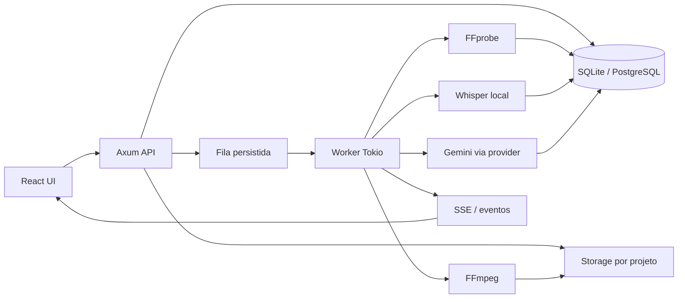
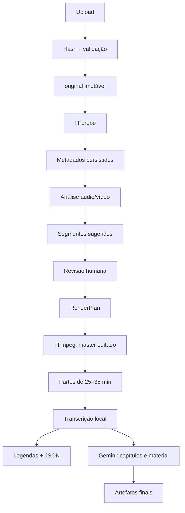

# Arquitetura

## 1. Análise crítica da especificação

A especificação está correta ao separar decisão de edição e execução multimídia. O risco principal seria transformar o MVP em um editor completo antes de validar o pipeline. A primeira versão deve resolver o caminho upload → probe → análise → proposta → renderização, com revisão humana e rastreabilidade.

### Ajustes recomendados

1. **SQLite no MVP.** É suficiente para uma instalação local, remove dependência operacional e mantém a camada de persistência compatível com PostgreSQL via SQLx. PostgreSQL só entra quando houver múltiplos workers, acesso remoto ou concorrência real.
2. **Um worker inicialmente.** Uma fila persistida e um worker com limite de um subprocesso FFmpeg evitam disputa por CPU e I/O. A fila pode ser paralelizada depois sem mudar o contrato dos jobs.
3. **Um master editado antes dos episódios.** O pipeline gera um arquivo canônico revisado; as partes são derivados desse master. Isso facilita reexportar, gerar legendas e manter offsets consistentes.
4. **IA apenas como proposta.** Gemini pode sugerir capítulos, retakes e títulos, mas não pode alterar segmentos diretamente. Toda sugestão vira uma decisão auditável.
5. **Transcrição pós-render no MVP.** Isso evita transcrever conteúdo que será removido. Uma etapa opcional de pré-transcrição pode ser adicionada quando a detecção semântica de retakes justificar o custo.
6. **Segmentação semântica é sugestão, não requisito de render.** Dividir exatamente em 30 minutos é uma operação determinística; encontrar bons limites depende de transcrição e pode gerar uma nova proposta.

### O que fica fora do MVP

- autenticação e multiusuário;
- edição frame a frame;
- colaboração em tempo real;
- microserviços;
- bindings diretos para libav*;
- RAG de documentos externos;
- aceleração de hardware obrigatória;
- redução de ruído pesada por modelo neural.

Esses itens têm valor, mas não são necessários para validar o fluxo principal.

## 2. Arquitetura recomendada

Monólito modular com dois processos lógicos:

```text
Browser (React/TypeScript)
        │ REST + SSE
        ▼
Rust API (Axum/Tokio)
        ├── domínio e regras de timeline
        ├── storage de arquivos
        ├── persistência SQLite/PostgreSQL
        ├── fila persistida de jobs
        └── worker de mídia/IA
                ├── FFprobe/FFmpeg
                ├── provider de transcrição local
                └── provider Gemini
```

API e worker podem começar no mesmo binário. A fronteira entre eles deve ser uma fila de jobs, para que o worker possa virar um processo separado sem remodelar o domínio.

### Componentes

| Componente | Responsabilidade | Não deve fazer |
|---|---|---|
| `api` | HTTP, upload, comandos e SSE | rodar FFmpeg dentro da requisição |
| `domain` | projeto, timeline, decisões e estados | conhecer detalhes de HTTP ou shell |
| `storage` | paths seguros, arquivos e hashes | interpretar vídeo |
| `ffmpeg` | montar e executar comandos parametrizados | decidir quais cortes são corretos |
| `media` | probe e análises determinísticas | chamar Gemini |
| `jobs` | fila, progresso, cancelamento e retry | conter regra de edição |
| `transcription` | contrato de provider e timestamps | gerar conteúdo didático |
| `ai` | prompts, schemas e respostas textuais | manipular vídeo |
| `export` | RenderPlan, naming e artefatos | sobrescrever `original/` |

## 3. Diagrama de componentes



## 4. Fluxo completo dos dados



Cada transição deve registrar job, entradas, versão da regra, comando externo quando aplicável e resultado. Um job reexecutado deve gerar um novo artefato ou reutilizar um artefato identificado pelo mesmo input hash e configuração.

## 5. Estrutura inicial do repositório

```text
video_editor/
├── backend/
│   ├── src/
│   │   ├── api/
│   │   ├── ai/
│   │   ├── audio/
│   │   ├── domain/
│   │   ├── export/
│   │   ├── ffmpeg/
│   │   ├── jobs/
│   │   ├── media/
│   │   ├── storage/
│   │   ├── transcription/
│   │   └── main.rs
│   └── migrations/
├── frontend/
├── tests/
├── docs/
└── storage/                 # runtime; não versionar arquivos de mídia
```

O frontend e o backend permanecem separados, mas o deployment local pode servi-los juntos. Não criar `workers/` como microserviço até existir uma necessidade operacional comprovada.

## 6. Crates Rust recomendadas

| Crate | Uso | Decisão |
|---|---|---|
| `tokio` | runtime, subprocessos e canais | base assíncrona do backend |
| `axum` | API REST e SSE | simples, integrado ao Tokio |
| `serde`, `serde_json` | contratos JSON e FFprobe | formato de integração natural |
| `sqlx` | SQLite agora, PostgreSQL depois | migrations e queries verificáveis |
| `uuid` | IDs internos | evita expor nomes de arquivos |
| `sha2` | hash dos uploads | deduplicação e rastreabilidade |
| `tracing`, `tracing-subscriber` | logs estruturados | observabilidade sem framework próprio |
| `thiserror`, `anyhow` | erros de domínio e contexto | separa erro tratável de contexto operacional |
| `chrono` | timestamps persistidos | suficiente para o MVP |
| `tower-http` | limites e middleware HTTP | integrações comuns do Axum |
| `reqwest` | chamada ao provider Gemini | isolada atrás do módulo `ai` |

Não usar uma crate de binding FFmpeg neste estágio: subprocessos versionados são mais fáceis de instalar, observar e substituir.

## 7. Estratégia de jobs

Estados persistidos:

```text
QUEUED → RUNNING → COMPLETED
                 ├→ FAILED
                 └→ CANCELED
```

O job contém `type`, `project_id`, `input_json`, `progress`, `current_step`, timestamps, erro resumido e caminho do log. O worker:

1. reivindica um job `QUEUED` dentro de uma transação;
2. muda para `RUNNING` antes de iniciar subprocessos;
3. emite eventos de progresso e grava logs;
4. atualiza o resultado de forma idempotente;
5. marca `COMPLETED`, `FAILED` ou `CANCELED`.

O progresso do FFmpeg vem de `-progress pipe:1`, não de texto humano do stderr. SSE é suficiente para a primeira interface; WebSocket só será necessário se a UI exigir comunicação bidirecional contínua.

**Simplificação deliberada:** um worker e um job de mídia por vez no MVP. `ponytail: aumentar concorrência somente após medir tempo de fila, CPU, RAM e I/O; usar pool por tipo de recurso.`

## 8. Principais riscos técnicos

| Risco | Impacto | Mitigação |
|---|---|---|
| entradas com codecs/parâmetros incompatíveis | concatenação falha ou exige reencode | probe prévio e normalização para um perfil canônico |
| cortes em keyframes | imprecisão com stream copy | reencode quando a precisão superar a economia |
| áudio com VFR, timestamps ruins ou streams ausentes | offsets incorretos | preservar dados de timestamp e validar após render |
| silenço legítimo em aula | corte indevido | confiança + revisão humana; nunca autoaprovar ambíguos |
| saída de FFmpeg incompleta | job preso ou artefato corrompido | timeout, exit status, validação pós-probe e arquivos temporários |
| processo Whisper/Gemini indisponível | pipeline parcial | estados independentes e artefatos anteriores preservados |
| custo/latência do Gemini | operação imprevisível | enviar texto, chunking, cache por hash e opt-in |
| arquivos não confiáveis | path traversal e consumo excessivo | nomes internos, limites, diretórios por UUID e timeout |
| alterações de regras | resultados não reproduzíveis | versão do pipeline no job e no artefato |

## 9. Milestones

### M1 — Fundação e ingestão

Projeto Rust, SQLite, migrations, projetos, upload seguro, hash, storage, FFprobe e job observável.

### M2 — Análise e render determinístico

`silencedetect`, `blackdetect`, `freezedetect`, `volumedetect`, normalização `loudnorm`, concatenação, RenderPlan e master editado.

### M3 — Revisão de cortes

Timeline lógica, player, sugestões de corte, manter/cortar, preview contextual e exportação revisada.

### M4 — Transcrição e legendas

Provider local, timestamps, SRT/VTT/JSON e derivação por episódio.

### M5 — Conteúdo didático

Provider Gemini, capítulos, resumo, glossário, questões e material versionado.

### M6 — Qualidade operacional

Waveform, thumbnails, aceleração opcional, benchmarks, PostgreSQL opcional e separação do worker se necessário.

## 10. MVP objetivo

O MVP está concluído quando o usuário consegue:

1. criar um projeto;
2. enviar e ordenar vídeos;
3. inspecionar metadados via FFprobe;
4. executar análise básica de áudio/vídeo;
5. revisar sugestões de silêncio e aceitar/rejeitar cortes;
6. gerar um `RenderPlan` auditável;
7. renderizar um master sem alterar os originais;
8. dividir o master em partes próximas de 30 minutos;
9. nomear e baixar os artefatos;
10. transcrever localmente e gerar SRT;
11. solicitar resumo/material ao Gemini, quando configurado.

O primeiro incremento de código deve parar após o item 3. Isso valida armazenamento, probe e jobs antes de introduzir filtros, edição ou IA.

