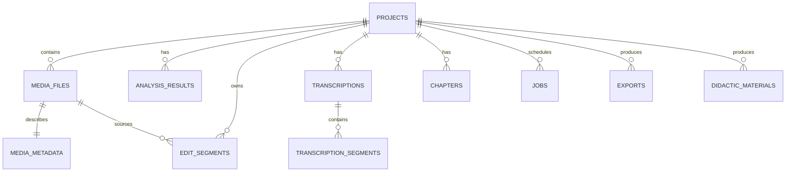

# Banco de dados inicial

SQLite no modo local, com SQLx migrations. Os tipos e constraints devem permanecer compatíveis com PostgreSQL. UUIDs são IDs públicos; nomes de arquivos são metadados.

## Entidades

## Tabelas principais

### `projects`

`id`, `name`, `slug`, `status`, `created_at`, `updated_at`.

### `media_files`

`id`, `project_id`, `original_name`, `storage_path`, `order_index`, `size_bytes`, `sha256`, `status`, `created_at`.

`storage_path` aponta somente para o storage interno; o original não é atualizado.

### `media_metadata`

`media_file_id`, `duration_ms`, `width`, `height`, `fps_num`, `fps_den`, `video_codec`, `audio_codec`, `sample_rate`, `channels`, `bitrate`, `raw_probe_json`.

### `analysis_results`

`id`, `project_id`, `media_file_id`, `kind`, `start_ms`, `end_ms`, `confidence`, `payload_json`, `rule_version`, `created_at`.

`kind` pode ser `silence`, `black`, `freeze`, `clipping`, `low_volume` ou `missing_audio`.

### `edit_segments`

`id`, `project_id`, `media_file_id`, `start_ms`, `end_ms`, `action`, `reason`, `confidence`, `decided_by`, `rule_version`.

`action` é `KEEP`, `REMOVE`, `REVIEW` ou `PENDING`.

### `transcriptions` e `transcription_segments`

Provider, modelo, idioma, caminho do artefato, status e segmentos com `start_ms`, `end_ms`, `text` e `words_json` opcional.

### `chapters`

`project_id`, `start_ms`, `end_ms`, `title`, `source`, `confidence`, `approved`.

### `jobs`

`id`, `project_id`, `type`, `status`, `progress`, `current_step`, `input_json`, `result_json`, `error`, `log_path`, `created_at`, `started_at`, `finished_at`.

### `exports`

`id`, `project_id`, `parent_export_id`, `part_number`, `title`, `storage_path`, `duration_ms`, `profile_json`, `status`.

### `didactic_materials`

`id`, `project_id`, `kind`, `provider`, `prompt_version`, `input_hash`, `storage_path`, `content_json`, `created_at`.

## Decisões de persistência

- não criar `users` no MVP local;
- guardar JSON bruto de ferramentas externas para auditoria;
- usar inteiros em milissegundos na timeline;
- indexar `project_id`, `status`, `order_index` e intervalos consultados;
- não guardar frames ou waveform no banco: são artefatos derivados no storage.

