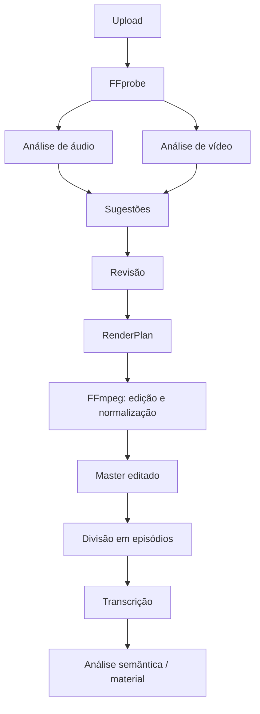

# Pipeline de mídia



## Fases

### 1. Upload

O arquivo é gravado em um temporário, recebe UUID interno e hash SHA-256, passa por limites de tamanho e é movido para `projects/<id>/original/`. O nome original é apenas metadado; comandos usam paths internos gerados pelo sistema.

### 2. Probe

FFprobe fornece duração, streams, codecs, dimensões, FPS, bitrate, sample rate, canais e metadata. A resposta JSON bruta é preservada para diagnóstico e os campos usados pela aplicação são normalizados em colunas.

### 3. Análise

As análises são sugestões independentes por arquivo e por stream. Um resultado tem intervalo, tipo, score, evidência, ferramenta e versão da regra.

```json
{
  "start_ms": 821400,
  "end_ms": 838100,
  "type": "silence",
  "confidence": 0.96,
  "suggestion": "remove",
  "evidence": {"noise_db": -52.1}
}
```

### 4. Timeline lógica

Segmentos usam milissegundos inteiros para evitar drift de ponto flutuante. Estados de decisão:

```text
KEEP | REMOVE | REVIEW | PENDING
```

`PENDING` é o estado inicial de uma sugestão; apenas `KEEP` e `REMOVE` entram no RenderPlan aprovado.

### 5. Render

O RenderPlan referencia fontes, intervalos, filtros e perfil de saída. O módulo de exportação converte esse plano em argumentos de `Command`, nunca em uma string de shell.

O output é gravado em arquivo temporário, validado com FFprobe e só então promovido a `output/`.

### 6. Episódios

O algoritmo procura uma pausa próxima de 30 minutos dentro de uma janela de 25–35 minutos. Se não houver candidato, usa o ponto mais próximo de 30 minutos. A sugestão semântica do Gemini pode substituir esse ponto em uma execução posterior aprovada.

### 7. Artefatos

```text
storage/projects/<project-uuid>/
├── original/       # somente leitura após ingestão
├── proxy/          # opcional
├── audio/          # análises e intermediários
├── analysis/       # JSON de probe/análises
├── transcription/  # transcript, SRT e VTT
├── output/         # master e episódios
└── material/       # conteúdo didático
```

